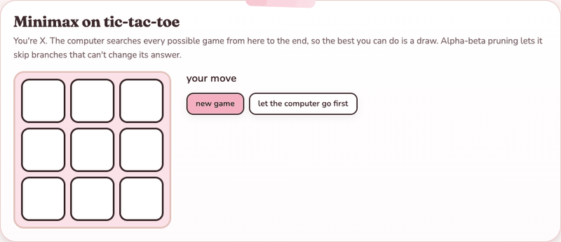

# Minimax Game Engine

A minimax engine with alpha-beta pruning in C++, with Tic-Tac-Toe, Gomoku, Othello and Chess plugged into it and a small Windows GUI to play against the computer.

## Demo



Recorded from the interactive demo on my portfolio, a JavaScript port of the engine playing tic-tac-toe. It also shows how many positions alpha-beta skipped. [Try it in your browser](https://nicole-li7.github.io/projects/search.html). The app itself is a Win32 program, so it runs only on Windows.

## Features

- **Four games, one engine**: the engine only sees an abstract `GameState` (legal moves, the state a move leads to, a score, whose turn it is). Each game implements that interface.
- **Alpha-beta pruning**: keeps track of the best score each side is already guaranteed and stops exploring a branch as soon as it can't beat it.
- **Move ordering**: moves get a quick one-step evaluation and are tried best-first, so far more of the tree is pruned.
- **Depth limit**: `Minimax::best_move(state, depth)` searches as many plies as you ask for; tic-tac-toe is solved completely, the bigger games use a heuristic score at the depth limit.

## Getting started

Open `minimax.vcxproj` in Visual Studio (Windows) and run it.

## How it's built

```
GameState.h        the interface every game implements
Minimax.h/.cpp     alpha-beta search
TicTacToe, Gomoku, Othello, Chess   the games
main.cpp           Win32 GUI
```

See also [astar](https://github.com/nicole-li7/astar), the puzzle-solving half of the same project.
