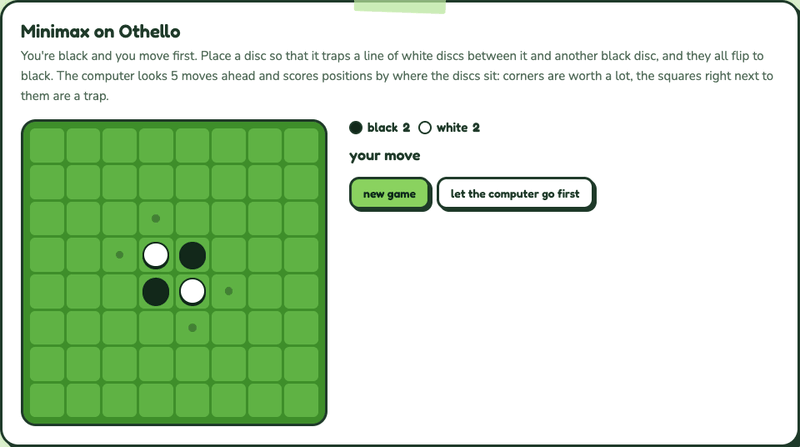
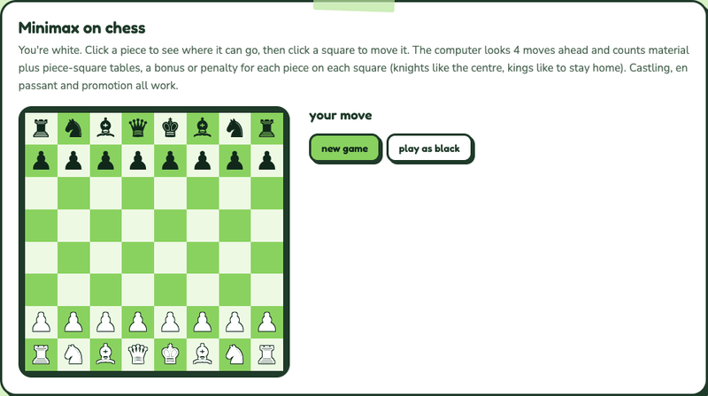

# Minimax Game Engine

A minimax engine with alpha-beta pruning in C++, with Tic-Tac-Toe, Gomoku, Othello and Chess plugged into it and a small Windows GUI to play against the computer.

## Demo

### Tic-tac-toe


Small enough to search every game to the end, so the best you can do is a draw.

### Othello



Searches 5 moves ahead and scores the board with a positional weight table (corners are worth a lot, the squares next to them are a trap). In the middle of a game, alpha-beta skips roughly 80 to 95% of the positions a plain minimax would look at.

### Chess



Searches 4 moves ahead and scores material plus piece-square tables. Supports castling, en passant and promotion.

All three are recorded from the interactive demos on my portfolio, which are JavaScript ports of this engine with the same rules, scoring and search depths. [Try them in your browser](https://nicole-li7.github.io/projects/search.html). The app itself is a Win32 program, so it runs only on Windows.

## Features

- **Four games, one engine**: the engine only sees an abstract `GameState` (legal moves, the state a move leads to, a score, whose turn it is). Each game implements that interface.
- **Alpha-beta pruning**: keeps track of the best score each side is already guaranteed and stops exploring a branch as soon as it can't beat it.
- **Move ordering**: moves get a quick one-step evaluation and are tried best-first, so far more of the tree is pruned.
- **Depth limit**: `Minimax::best_move(state, depth)` searches as many plies as you ask for; tic-tac-toe is solved completely, the bigger games use a heuristic score at the depth limit.

## Getting started

Open `minimax.vcxproj` in Visual Studio (Windows) and run it.

## How it's built

```
GameState.h        the interface every game implements
Minimax.h/.cpp     alpha-beta search
TicTacToe, Gomoku, Othello, Chess   the games
main.cpp           Win32 GUI
```

See also [astar](https://github.com/nicole-li7/astar), the puzzle-solving half of the same project.
